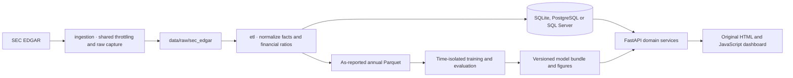

# FinHealth Production V1.0

Nền tảng phân tích sức khỏe tài chính và dự báo rủi ro phá sản 12 tháng đa tổ chức (Multi-Tenant B2B) kết hợp lõi học máy **Kaggle `v2.0.0-kaggle` (0% leakage, bất biến đơn vị tiền tệ)**, lớp đối chiếu **SEC EDGAR (`10-K`/`10-Q`)**, chuẩn kế toán Việt Nam (**TT99/2025/TT-BTC**, **TT200/2014**, **TT133/2016**, **Import XML HTKK**), xuất **Báo cáo PDF A4 tiếng Việt** & **Thẩm định Hàng loạt Excel**, và tuân thủ **Luật Bảo vệ dữ liệu cá nhân 91/2025/QH15** cùng miễn trừ **Nghị định 88/2014/NĐ-CP**.

## Điểm nổi bật bản phát hành V1.0

- **Lõi ML Dự báo Phá sản 12 tháng (`v2.0.0-kaggle`):** Huấn luyện trên `data/raw/kaggle/american_bankruptcy.csv` (8.971 DN, 78.682 dòng, 609 sự kiện phá sản đúng năm `year == max_year`: 490 Train / 62 Val / 57 Test, **0% entity leakage**). Dùng 19 tỷ số không thứ nguyên (`CORE_BANKRUPTCY_FEATURES`, bất biến VND = USD), Platt-calibrate đồng đều 4 mô hình (LR, RF, XGBoost, LightGBM), Độ tin cậy 4 lớp, ánh xạ đơn điệu `PD ↔ Điểm Sức khỏe 0–100` (`STRONG / STABLE / WATCH / CRITICAL`) và Cash-Flow Overlay.
- **Đa Tổ chức & Phân quyền RBAC (`organizations`):** Tự động tạo Workspace cá nhân khi xác thực email OTP; hỗ trợ tạo nhiều tổ chức, chuyển `active_org_id` phía server, mời thành viên bằng token SHA-256 (72h), phân quyền `org_admin` / `analyst` / `viewer`, cô lập dữ liệu tuyệt đối theo `org_id`.
- **Tuân thủ Pháp lý VN 2026:**
  - **Luật 91/2025/QH15:** Tự xuất dữ liệu cá nhân (`GET /api/v1/auth/me/export`) và tự xóa tài khoản kèm OTP (`POST /api/v1/auth/delete-account`) thu hồi phiên tức thì và xóa sạch PII.
  - **Nghị định 88/2014/NĐ-CP:** Miễn trừ trách nhiệm pháp lý gắn trên mọi kết quả thẩm định & PDF; không hiển thị nhãn xếp hạng tín nhiệm `AAA..CCC` trên UI khách hàng.
- **Nhập BCTC chuẩn Việt Nam (`org_companies`):** Web Form 3 phần (Lưu nháp / Chốt `finalized`, đơn vị Đồng/Triệu/Tỷ), bộ kiểm tra cân đối kế toán (`TA = TL + E` dung sai 0,5%), biểu mẫu Excel `.xlsx` và **Import XML HTKK (`defusedxml`, chặn XXE ≤ 5 MB)** cho **TT99/2025**, **TT200/2014**, **TT133/2016**; chặn chấm điểm Altman/ML tường minh cho Tổ chức tín dụng (`financial_institution`); nạp nhanh 3 hồ sơ DN mẫu VN (`POST /api/v1/org/samples/seed`).
- **Phân tích 5 Trụ cột & Báo cáo (`org_analytics`, `reporting_v2`):** Altman đủ 3 biến thể $Z / Z' / Z''$ với ngưỡng động, 5 Trụ cột & 20 chỉ số có tooltip tiếng Việt, bảng 2 cột **Điểm Tựa & Điểm Nghẽn** bằng ngôn ngữ nghiệp vụ, lịch sử 3–5 năm, so sánh 2–4 DN, xuất **PDF A4 tiếng Việt** (`reportlab` + font Unicode `DejaVuSans` nhúng, chạy đa nền tảng không cần GTK), và **Thẩm định Hàng loạt Excel bất đồng bộ** (`POST /api/v1/org/batch/jobs` + `export.xlsx`).
- **React SPA Song song (`frontend/`):** Hai không gian tác nghiệp song song **Danh bạ DN Tổ chức (`/portfolio`)** và **Thị trường Mỹ SEC (`/us-market`)**, cùng `/batch`, `/compare`, `/stress`, `/methodology`, `/organization`, `/account`, và cổng quản trị `/admin` (hấp thụ `ModelLab` & `ClusterMap` chỉ dành cho Admin).

## Clone và chạy trên máy mới

Repo có mã nguồn, dữ liệu tài chính, mô hình (`v1.2.0`, `v2.0.0-kaggle`) và ảnh biểu đồ đã được chủ dự án cho phép
bàn giao. Snapshot chỉ chứa các bảng tài chính công khai; không có tài khoản, mật khẩu, phiên
đăng nhập, OTP hoặc dữ liệu cá nhân.

Xem **[hướng dẫn cài đặt và khôi phục SQL Server](docs/clone-and-run.md)** để clone,
cài Python, nạp dữ liệu và tạo tài khoản quản trị riêng. Có cả cách chạy bằng SQLite.

## Launch

Account sessions, optional Gmail SMTP, personal workspaces and SQL Server administration
are described in [the security and accounts guide](docs/security-and-accounts.md).
Apply `alembic upgrade head` before restarting; administrator accounts are provisioned
locally, and public company research does not require login.

From the repository root, activate the Python environment and start the complete application.

```powershell
.\.venv\Scripts\Activate.ps1
uvicorn finhealth.api.main:app --host 127.0.0.1 --port 8000
```

Open [the API documentation](http://127.0.0.1:8000/docs).
The backend API is served by FastAPI. `FRONTEND_DIR` can be configured to point to a
new frontend static root when available (defaults to `frontend`).

The alternative factory entry point is
`uvicorn finhealth.api.main:create_app --factory --host 127.0.0.1 --port 8000`.

For a new Python environment, install the package and development tools first.

```powershell
python -m venv .venv
.\.venv\Scripts\Activate.ps1
pip install -r requirements.lock -e ".[dev,sqlserver]"
Copy-Item .env.example .env
```

The local workspace may contain the SEC cache and model bundle, with financial records
in the configured SQL Server database or an optional SQLite snapshot.
The owner-authorized public financial data and model bundles are included in this handoff.
Restore `data/seed/financial.sqlite3` using the clone guide before starting the application.
Original databases, backups, secrets and private account records remain excluded.

Settings use the configured SQL Server instance when neither `DATABASE_URL` nor
explicit `POSTGRES_*` fields are set. `DATABASE_URL` takes precedence over both.
For SQLite, set `DATABASE_URL=sqlite:///data/processed/parquet/finhealth.sqlite3` in
`.env`. The onboarding example includes PostgreSQL fields for the Docker workflow.
For PostgreSQL, start `docker compose up -d postgres` and apply `alembic upgrade head`.
The app loads the trusted bundle named in `data/artifacts/models/latest.json` at startup.
The active local bundle is `data/artifacts/models/v1.2.0`.

### Kết nối SQL Server

Cài driver ODBC SQL Server cùng kiến trúc với Python và chạy
`pip install -e ".[dev,sqlserver]"`. Trong SSMS, kết nối `ADMIN-PC` bằng
**Windows Authentication** và tạo một cơ sở dữ liệu riêng, ví dụ `finhealth_db`.
Tài khoản chạy ứng dụng cần đọc và ghi các bảng của FinHealth. Tài khoản chạy
migration cần quyền tạo và sửa cấu trúc bảng.

Trong `.env`, đặt:

```dotenv
DATABASE_URL="mssql+pyodbc://ADMIN-PC/finhealth_db?driver=ODBC+Driver+17+for+SQL+Server&Encrypt=yes&TrustServerCertificate=yes"
```

`TrustServerCertificate=yes` dành cho instance cục bộ dùng chứng chỉ tự ký.
Với máy chủ có chứng chỉ đáng tin cậy, dùng `TrustServerCertificate=no`.
Dùng đúng tên driver xuất hiện trong `Get-OdbcDriver`.

Từ thư mục gốc, chạy `alembic upgrade head` nếu muốn khởi tạo bảng trống.
Để chuyển dữ liệu SQLite có sẵn, chạy lệnh sau với cơ sở dữ liệu SQL Server đích
riêng và chưa có dữ liệu. Lệnh áp dụng migration, sao chép, rồi kiểm tra toàn bộ
các dòng trước khi xác nhận giao dịch:

```powershell
python -m finhealth.db.handoff restore
```

Khởi động lại API sau khi đổi cấu hình. SQLite gốc có thể dùng để quay lại bằng
cách đặt `DATABASE_URL=sqlite:///data/processed/parquet/finhealth.sqlite3` và
khởi động lại. Raw JSON, Parquet và gói mô hình vẫn được đọc từ hệ thống tệp.
API và CLI huấn luyện dùng `DATABASE_URL` trong `.env`. Nếu cần ghi dữ liệu panel
vào cơ sở dữ liệu khác trong một lần chạy CLI, truyền `--database-url`.

## Analytical workspaces

### Phiên bản dữ liệu 1.3

Chạy `alembic upgrade head` trước khi khởi động. Migration 0004 bổ sung
`filing_versions`, `forecast_evidence` và `ingestion_runs`. Bản chụp từ DB cũ
mang nhãn `legacy_snapshot`. Bản dự báo cũ được đánh dấu `legacy_unverified`
vì dữ liệu lưu trước đây không đủ để xác nhận toàn bộ đầu vào gốc.

- **Kho báo cáo** chọn nguồn SEC hoặc thí điểm FPT/HPG, phiên bản và mốc công bố.
  `GET /api/v1/reports/{identifier}` cung cấp số liệu và nguồn, có tham số `as_of`.
  Mốc này dựa trên ngày công bố, với phạm vi giới hạn ở hồ sơ đã thu nhận.
- `GET /api/v1/filings/{id}/forecasts` đọc kết quả và đầu vào đã lưu theo phiên bản.
  `GET /api/v1/data-quality` cho biết độ phủ chỉ tiêu của báo cáo năm gần nhất.
  `GET /api/v1/report-alerts/{identifier}` phát hiện thay đổi giữa hai bản công bố cùng kỳ.
- `GET /api/v1/companies` lọc trước khi phân trang bằng `q`, `sector`, `risk_level`,
  `cluster_id`, `fiscal_year`, `min_roa`, `max_debt_ratio`, `min_current_ratio`.
  Tỷ số trong API dùng số thập phân, ví dụ ROA 5% là `min_roa=0.05`.
  Khoảng lọc yêu cầu có số liệu thực, điểm đối chiếu vẫn dùng tập doanh nghiệp đầy đủ.
- `python -m finhealth.ingestion.backfill` nạp quý từ cache hiện có.
  Quý SEC đối chiếu ngày kết thúc kỳ với `reportDate` trong hồ sơ submissions.
  Q4 được tính từ năm trừ ba quý đã quan sát khi các kỳ và chỉ tiêu tương thích.
  Bản sửa đổi `10-K/A`, `10-Q/A` chỉ chứa số liệu tìm được đúng accession; chuỗi quý và mô hình
  dùng hồ sơ gốc để tránh trộn các chỉ tiêu của bản sửa đổi thiếu dữ liệu.
  `python -m finhealth.ingestion.backfill --vietnam-pilot` nạp các dòng VND đã đối soát
  từ báo cáo gốc. Tập Việt Nam chỉ dùng để đọc báo cáo.
- `INGESTION_WORKER_ENABLED=true` bật hàng đợi cập nhật SEC trong một tiến trình API.
  Khi triển khai staging/production, truyền `Authorization: Bearer <ADMIN_TOKEN>`
  cho route ghi. Chỉ chạy một dispatcher cho mỗi danh tính SEC.
- `python -m finhealth.ml.recheck --output <path>` đánh giá các cửa sổ lịch sử
  trên Parquet SEC hiện có và không phát hành gói mô hình mới.

| Workspace | Capabilities |
| --- | --- |
| Market screener | Latest annual snapshots, search, risk/regime/year filters, multi-column sorting, filtered CSV, risk distributions and a PCA preview |
| Company analysis | Credit ratios, peer ranks, composite health score, 3-step DuPont and ROE bridge, cash-flow accruals, accounting checklist, stress presets, printable credit memo and annual history CSV |
| Compare companies | Select 2–4 issuers for aligned annual observations, selected cohort medians and historical/forecast overlays |
| Risk attribution | Forward probability gauge, validation-selected threshold, signed TreeSHAP bars, all 17 input values and contributions, Altman component breakdown |
| Models and regimes | Interactive PC1 × PC2/PC3 map, company drilldown, cluster centroids, classification and regression benchmarks, seven original 300-DPI figures |

The selector and verified benchmark chips switch companies. Shift-click table headings
adds sort columns. Missing observations appear as an em dash and break trajectory lines.
Forecasts connect to the actual target fiscal year with a dashed line and shaded region.
Pointer and keyboard focus reveal chart values. Enter on a PCA point opens the company.
Tabs support arrow keys, Home and End. Escape closes the publication-figure lightbox.

The SEC form invokes `POST /api/v1/companies/{identifier}/analyze?force_refresh=true`.
It uses the configured SEC contact, shared limiter and bounded retry logic, then persists
financials and annual model predictions transactionally. The UI reports loading and server
errors and refreshes the universe after a successful update. A monitored contact in
`SEC_USER_AGENT=AppName/Version (ContactEmail)` is required for real SEC access.
Follow the single-dispatcher restrictions in `src/finhealth/ingestion/README.md` when
running multiple workers or machines.

## Architecture



| Package or directory | Responsibility |
| --- | --- |
| `src/finhealth/core` | Environment configuration, logging and domain errors |
| `src/finhealth/db` | SQLAlchemy models, repositories, sessions and migration integration |
| `src/finhealth/ingestion` | SEC clients, retries, raw responses and request admission |
| `src/finhealth/etl` | XBRL concept/context selection, accounting scope, ratios and temporal features |
| `src/finhealth/ml` | Preprocessing, PCA/K-Means, next-period models, baselines, SHAP and artifacts |
| `src/finhealth/api` | Validated contracts, thin routes and domain orchestration |
| `tests/unit` and `tests/integration` | Offline invariants, database/API boundaries and forensic verification |

| Route | Data |
| --- | --- |
| `GET /` | Configured frontend `index.html` (returns 503 when no frontend is present) |
| `GET /static/*` | Configured frontend static assets |
| `GET /api/v1/health` | Database connectivity and model activation |
| `GET /api/v1/dashboard/overview` | Actual company and annual-statement counts |
| `GET /api/v1/companies` | Latest persisted company snapshots |
| `GET /api/v1/companies/compare` | Two to four annual snapshots, optional common fiscal year, matched stored forecasts and historical series |
| `GET /api/v1/companies/{identifier}` | Annual history, forecast, feature inputs, Altman components and sector peer percentiles |
| `POST /api/v1/companies/{identifier}/analyze` | SEC retrieval, normalization, inference and persistence |
| `POST /api/v1/companies/{identifier}/simulate` | Read-only annual accounting sensitivity with baseline and stressed predictions |
| `GET /api/v1/clusters/map` | Latest persisted PCA positions and cluster labels |
| `GET /api/v1/models/evaluation` | Exact active bundle evaluation report |
| `POST /api/v1/models/train` | Explicit fit and activation of a new model version. Accepts `validation_end_year` and defaults to the first forward validation year when sufficient observations remain. |
| `GET /api/v1/figures/*` | Original publication PNGs |

Importing the application module does not instantiate settings, connect to SQL, create
directories or load model artifacts. Uvicorn resolves the lazy `app` attribute when
starting the server. Explicit settings can set `frontend_dir`, data and model paths.
Static mounts expose only the frontend and figures directories.

Product version 1.3.0 serves the active v1.2.0 model. Comparison uses the selected
annual statement as its forecast origin. Historical comparison displays no forecast
when that statement lacks a stored prediction for the active model. Operating
margin is a historical series. The accounting checklist has eight observed-only
signals inspired by Piotroski. The composite 0–100 is a relative accounting score
and its attached research grade is internal. CSV downloads are produced in the
browser. The CIK field uses a leading apostrophe as its spreadsheet text marker.

## Audited benchmark

Benchmark `v1.2.0` uses 1,506 annual statements (`10-K`) from 98 cached SEC issuers
(1,047 training feature rows through FY2021). The supervised training sample contains
900 strictly forward filing pairs (`non_forward_supervised_rows = 0`). Calibration,
model selection, and forecast blend selection use 97 FY2022 validation observations
(16 positives). The embargoed classification test has 98 labeled observations,
including 15 positives (prevalence `0.153061`).

Across the candidate classifiers on the held-out test set, the validation-selected
`random_forest` model achieves ROC-AUC `0.975904`, PR-AUC `0.898999`, Brier score
`0.048583`, and F2 `0.833333` (vs. `lightgbm` Brier `0.053491` / ROC-AUC `0.959839`,
calibrated `xgboost` Brier `0.059193` down from `0.073316` raw / ROC-AUC `0.957430`,
`logistic_regression` Brier `0.149351` / ROC-AUC `0.960643`, and `altman_z_baseline`
Brier `0.201654` / ROC-AUC `0.903614`). The maximum raw TreeSHAP reconciliation error
is `1.03216047e-15`.

Reproduce the run from the local cache with

```powershell
python -m finhealth.ml.train_cli --offline --require-real --model-version v1.2.0
```

Use `--replace-existing` to archive and replace an already published local version.
See `data/artifacts/models/v1.2.0/BENCHMARK_REPORT.md` for full results. ROA, ROE, EPS,
and OCF all beat naive persistence on both paired R² and MAE. The debt forecast ties
persistence (`weight = 0.0`).

Classification predicts a fundamentals-based forward distress proxy. Altman uses the
requested book-equity manufacturing proxy or the nonmanufacturing Z″ formula and
operating income as an EBIT proxy. AAL and LUMN liabilities can include explicitly
recorded accounting derivations. The selected issuer panel and proxy targets determine
the scope of these results. Annual forecast deltas are in percentage points, except EPS
which is in USD per share.

Peer ranks use the most recent annual snapshot per company with an observed value.
The displayed cohort includes the selected issuer. Sectors with fewer than five
eligible annual snapshots use the industrial universe. Stress tests use a static
balance sheet sensitivity and show each assumption in the results. The memo exports
through the browser print dialog, including its Save as PDF option.

### Manual Financial Scoring & TreeSHAP (`POST /api/v1/models/predict-manual`)

- Manual and batch prediction require a verified login session and CSRF token.
- The **Dự báo thủ công** workspace (`#manual`) allows users to enter annual financial
  statement figures directly (with optional prior-year balances for YoY deltas) for any
  company without requiring a stored SEC CIK.
- `POST /api/v1/models/predict-manual` computes ratios, Altman Z/Z″, PCA regime, calibrated
  distress probability, `t+1` forecasts, OOD checks, and exact TreeSHAP attributions
  statelessly using the active model bundle without mutating the database.

### Kaggle US Company Bankruptcy Benchmark (`kaggle-v1.2.0`)

To complement the SEC EDGAR distress-proxy panel (`v1.2.0`), the pipeline was also trained
and evaluated on the real **Kaggle US Company Bankruptcy** dataset (`data/raw/kaggle/american_bankruptcy.csv`,
8,971 companies, 78,682 annual rows, 1999–2018) with observed corporate bankruptcy labels
(`Train <= 2014`: 66,400 feature rows / 57,218 supervised; `Validation 2015–2016`: 5,901 rows /
132 bankruptcies; `Test >= 2017`: 2,643 labeled rows / 36 bankruptcies):

| Model (`kaggle-v1.2.0`, Test >= 2017) | ROC-AUC | PR-AUC | F2 | Brier |
| --- | ---: | ---: | ---: | ---: |
| **XGBoost (selected on validation)** | **0.8075** | **0.0821** | **0.2577** | **0.0131** |
| LightGBM | 0.8017 | 0.0755 | 0.2000 | 0.0131 |
| Random Forest | 0.7985 | 0.0688 | 0.2475 | 0.0131 |
| Altman Z-Score baseline | 0.7262 | 0.0262 | 0.1200 | 0.2800 |
| Logistic Regression | 0.6804 | 0.0446 | 0.1054 | 0.2487 |

Full provenance and confusion matrices are stored in `data/artifacts/models/kaggle-v1.2.0/BENCHMARK_REPORT.md`.

## Verification

```powershell
ruff check .
mypy src/finhealth
pytest -v
```

The forensic suite requires the audited local data and bundle. The dashboard integration
suite requires the populated database and all seven publication figures. Unit tests run
offline. External SEC HTTP is replaced only at transport boundaries in ingestion tests.
Dashboard browser QA uses the real API. Response times are measured on the local
machine and are affected by CPU load, filesystem cache and tracing.

The Stage 7 local HTTP measurement used 50 complete requests per endpoint after
one warm-up against Uvicorn on this workspace's Intel Core i5-6200U.

| Route | Median ms | P95 ms |
| --- | ---: | ---: |
| Dashboard HTML | 3.556350 | 4.619165 |
| Health | 3.219350 | 4.724330 |
| Companies | 10.421650 | 12.557965 |
| AAPL analysis | 8.299800 | 9.900455 |
| PCA map | 10.342750 | 12.300490 |
| Evaluation | 2.674500 | 4.018705 |

The terminal transcripts are retained in `data/artifacts/stage7/`, including
`http-latency.txt`, `frontend-checks.txt`, `ruff.txt`, `mypy.txt` and
`pytest.txt`. SVG generation was exercised with real AAPL/AAL observations and
all 81 PCA points. Visual browser inspection remains unverified because the
embedded browser failed to initialize and automatic approval review blocked
launching a headless Chrome debugging session.
