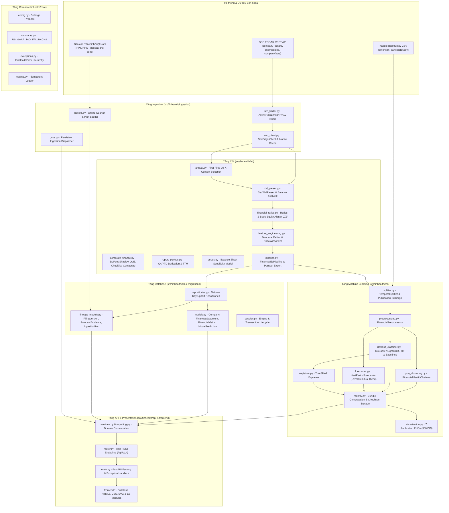

# BÁO CÁO ĐÁNH GIÁ KIẾN TRÚC VÀ THIẾT KẾ HỆ THỐNG (ARCHITECTURE REVIEW)

## 1. Kiến trúc Thực tế của Hệ thống (Actual System Architecture)

Dự án **FinHealth** được tổ chức theo mô hình phân lớp (layered modular monolith) sử dụng cấu trúc `src/finhealth` trên Python 3.10+ và giao diện web ES Modules không bước biên dịch (buildless frontend) được phục vụ cùng nguồn (same-origin) bởi FastAPI.

---

## 2. Phân tích Quan hệ Phụ thuộc và Phân tách Trách nhiệm (Dependency Direction & Separation of Concerns)

### 2.1. Điểm mạnh kiến trúc đã được xác minh (`VERIFIED`)
1. **Không có hiệu ứng phụ tại thời điểm import (Zero Import-Time Side Effects)**:
   - Không có bất kỳ module nào tự động mở kết nối DB, tạo thư mục trên đĩa, đọc tệp `.env` hay nạp mô hình ML khi `import`.
   - `finhealth.api.main` sử dụng PEP 562 module `__getattr__` (`main.py:138-142`) để chỉ khởi tạo `FastAPI` khi ASGI server truy cập thuộc tính `app`.
2. **Router mỏng, uỷ quyền hoàn toàn cho tầng dịch vụ (Thin Routers)**:
   - Toàn bộ 6 router trong `src/finhealth/api/routers/` (`companies.py`, `dashboard.py`, `health.py`, `ingestion.py`, `models.py`, `reports.py`) chỉ thực hiện khai báo dependency, kiểm tra điều kiện HTTP và gọi sang `FinancialAnalysisService` hoặc `reporting`. Không có logic toán học hay truy vấn ORM rải rác trong router.
3. **Hướng phụ thuộc một chiều sạch sẽ (Acyclic Dependency Direction)**:
   - `core` không phụ thuộc vào bất kỳ gói nội bộ nào.
   - `db` chỉ phụ thuộc `core`.
   - `ingestion` phụ thuộc `core`, `db` (chỉ có `jobs.py` là worker điều phối ở tầng ứng dụng gọi vào `api.services.FinancialAnalysisService`).
   - `etl` phụ thuộc `core`, `db`, `ingestion.schemas`.
   - `ml` phụ thuộc `core`, `db`, `etl`, `ingestion.schemas`.
   - `api` hợp nhất `core`, `db`, `ingestion`, `etl`, `ml`.
   - Không phát hiện vòng lặp `import` (circular dependency) gây lỗi khi nạp độc lập bất kỳ module nào.
4. **Quản lý giao dịch (Transactional Ownership) rõ ràng**:
   - Các class trong `db/repositories.py` chỉ gọi `session.flush()`, để quyền `commit()` hoặc `rollback()` cho tầng dịch vụ hoặc context manager của caller.
   - `FinancialEtlPipeline.persist_to_database()` sử dụng savepoint (`with session.begin_nested():`) để đảm bảo tính nguyên tử của toàn bộ lô báo cáo một công ty.

### 2.2. Các điểm yếu cấu trúc và vi phạm kiến trúc đã xác nhận
1. **Chia sẻ biến toàn cục `_MODEL_STATE` ở cấp module (`AUD-ARCH-001` - MEDIUM)**:
   - `src/finhealth/api/dependencies.py:101` khởi tạo singleton `_MODEL_STATE = ModelRegistryState()` và `create_app()` gán trực tiếp đối tượng toàn cục này vào `app.state.model_registry`.
   - Khi `ModelRegistryState.initialize(directory)` đã chạy một lần (`self._initialized = True`), các lần gọi `initialize()` tiếp theo với `directory` khác đều bị bỏ qua. Điều này phá vỡ tính đóng gói của mẫu thiết kế Application Factory (`create_app(settings)`).
2. **Tồn tại hai cơ chế tạo `Session` song song nhưng chỉ một cơ chế được sử dụng**:
   - `src/finhealth/db/session.py:55-71` định nghĩa `_default_session_factory()` và generator `get_db_session()` (tự động mở `with session.begin():`).
   - Tuy nhiên, toàn bộ ứng dụng FastAPI thực tế lại dùng hàm `get_db(request)` trong `src/finhealth/api/dependencies.py:104-118` (quản lý engine trên `request.app.state` và không tự động commit các route GET). Hàm `get_db_session()` trong `db/session.py` thực chất là dead code đối với runtime production, chỉ được gọi duy nhất trong tệp unit test `tests/unit/test_db_session.py`.

---

## 3. Luồng Dữ liệu & Kiểm soát Tính Nhất quán (Data Flows & Consistency Guarantees)

### 3.1. Phân tách giữa "Serving Panel" (Bảng hiện hành) và "Lineage Archive" (Kho lịch sử append-only)
- **Bảng Serving (`companies`, `financial_statements`, `financial_metrics`, `model_predictions`)**:
  - `financial_statements` áp dụng khóa tự nhiên `(company_id, fiscal_year, fiscal_period, form_type)`.
  - Với báo cáo năm (`10-K`), quy trình huấn luyện và phân tích gọi `as_reported_annual_payload()` (`src/finhealth/etl/annual.py:131-180`) để chọn **báo cáo đầu tiên được quan sát (first-observed filing)** cho mỗi kỳ kết thúc năm tài chính, loại bỏ các bản sửa đổi muộn để hạn chế thiên lệch nhìn trước (look-ahead bias).
- **Kho Lineage (`filing_versions`, `forecast_evidence`, `ingestion_runs`)**:
  - Mọi phiên bản báo cáo (bao gồm cả báo cáo cũ hơn, báo cáo quý `10-Q` đã xác thực ngày `reportDate`, bản sửa đổi `10-K/A`, `10-Q/A`, bản chụp cũ `legacy_snapshot` và báo cáo thí điểm Việt Nam `VN:FPT`, `VN:HPG`) được băm SHA-256 (`fingerprint`) và lưu bất biến vào `filing_versions`.
  - Khi một báo cáo trong `financial_statements` bị thay thế bởi bản nộp mới hơn, các dự báo cũ trong `model_predictions` được lưu trữ sang `forecast_evidence` trước khi xóa khỏi bảng serving (`repositories.py:205-218`).

### 3.2. Điểm đứt gãy tính nhất quán giữa File System và Database (`AUD-DATA-001`)
- Gói mô hình (`models.joblib`, `evaluation_report.json`, `metadata.json`, `latest.json`) được lưu trên hệ thống tệp (`data/artifacts/models/`), trong khi kết quả suy luận (`model_predictions`, `financial_metrics.pca_comp_*`, `cluster_id`) được lưu trong cơ sở dữ liệu quan hệ (SQLite / PostgreSQL / SQL Server).
- Khi chạy `train_cli.py`, nếu biến môi trường `DATABASE_URL` trong `.env` trỏ sang một cơ sở dữ liệu khác (ví dụ SQL Server), CLI sẽ cập nhật `latest.json` và gói mô hình trên đĩa nhưng chỉ ghi dự báo mới vào cơ sở dữ liệu của `.env`, bỏ lại tệp SQLite mặc định (`data/processed/parquet/finhealth.sqlite3`) ở trạng thái cũ. Đây chính là nguyên nhân gốc dẫn đến lỗi `AUD-DATA-001`.

---

## 4. Điểm lỗi Đơn lẻ, Lan truyền Lỗi và Rủi ro Mở rộng (SPOF, Failure Propagation & Scalability)

1. **Giới hạn Đơn Tiến trình (Single-Process / Single-Writer Assumptions)**:
   - `AsyncRateLimiter` (`src/finhealth/ingestion/rate_limiter.py`) chỉ đồng bộ hóa tốc độ gọi SEC trong một event loop của một tiến trình Python.
   - `atomic_write_json` (`src/finhealth/ingestion/sec_client.py:34-57`) dùng một tên tệp tạm cố định `.json.tmp` bảo vệ bởi khóa luồng nội bộ `_WRITE_LOCK = RLock()`. Nếu có 2 tiến trình (ví dụ 2 worker Uvicorn/Gunicorn) cùng ghi một tệp cache SEC trên cùng thư mục chia sẻ, chúng sẽ tranh chấp cùng một đường dẫn `.json.tmp`.
   - Hàng đợi `run_dispatcher` (`src/finhealth/ingestion/jobs.py`) sử dụng cơ chế optimistic claim qua SQL `UPDATE ... WHERE status='queued' AND attempts=...`, an toàn khi có một dispatcher nhưng tài liệu đã quy định rõ chỉ chạy một dispatcher cho mỗi danh tính SEC.
2. **Thực thi Tác vụ Nặng trong Tiến trình Web API**:
   - Endpoint `POST /api/v1/models/train` thực hiện huấn luyện toàn bộ 3 họ mô hình (XGBoost, LightGBM, Random Forest), 5 mô hình hồi quy + 5 mô hình phần dư, tính TreeSHAP và lưu đĩa ngay trong threadpool của tiến trình FastAPI (được tuần tự hóa bởi `state.training_lock`). Do GIL của Python và tải CPU của các thư viện C++ (XGBoost/LightGBM/Scikit-learn dù đã đặt `n_jobs=1`), tác vụ này có thể làm tăng độ trễ của các request đọc đồng thời trên cùng worker.
3. **Tính toán Phân vị Ngành trong Bộ nhớ (`AUD-PERF-001`)**:
   - Việc nạp toàn bộ danh sách chỉ số năm của tất cả công ty lên bộ nhớ Python thông qua `_annual_metrics(session)` mỗi khi gọi `/api/v1/companies` (có lọc/phân trang) hoặc `/api/v1/companies/{identifier}` hoạt động rất nhanh với 98 công ty hiện tại, nhưng sẽ không mở rộng tuyến tính nếu cơ sở dữ liệu tăng lên toàn bộ ~10,000 công ty niêm yết trên SEC EDGAR.
